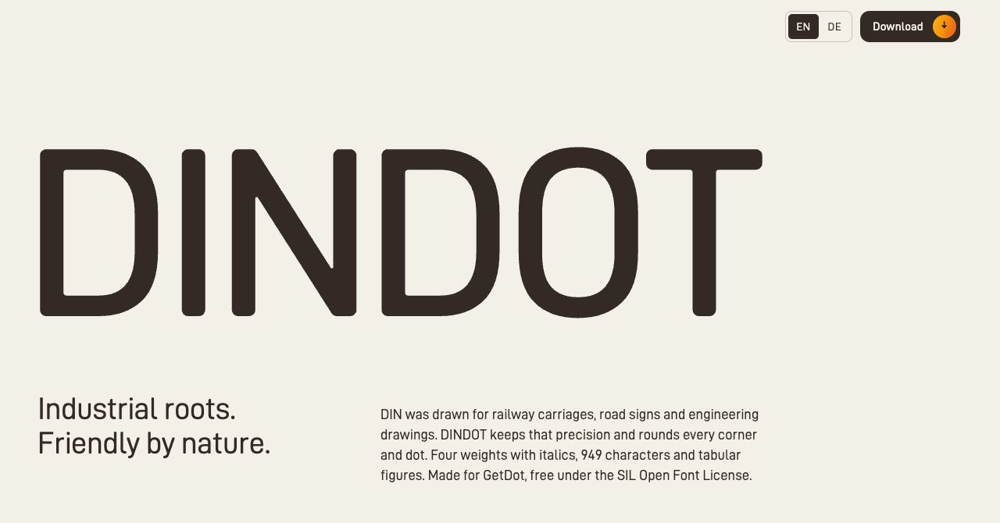
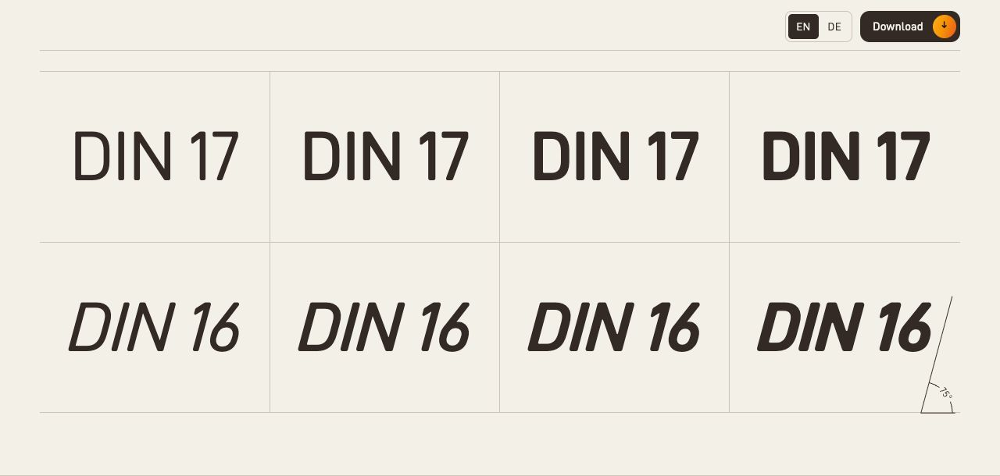
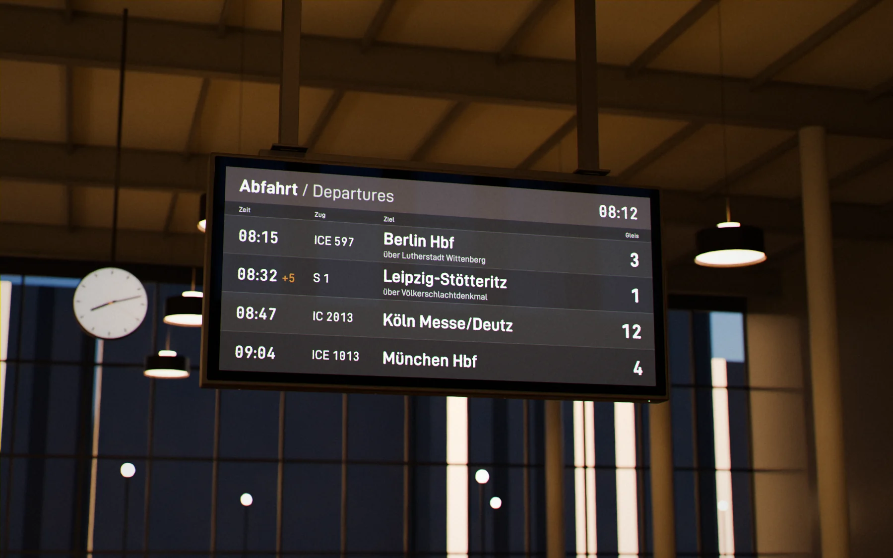

# DINDOT

Rounded industrial type by [GetDot](https://www.getdot.ai/), derived from
[DINish](https://github.com/playbeing/dinish).

**[Try the specimen](https://www.getdot.ai/dindot/)** · **[Download the release](https://github.com/Snowboard-Software/dindot/releases/latest)**

[](https://www.getdot.ai/dindot/)

Release **0.22.0** contains four weights with matching italics, supplied as
TrueType for desktop use and WOFF2 for self-hosted websites.

| Weight | Upright | Italic |
| --- | --- | --- |
| 400 | Regular | Italic |
| 500 | Medium | Medium Italic |
| 600 | SemiBold | SemiBold Italic |
| 700 | Bold | Bold Italic |

DINDOT has rounded corners, circular dots and tabular figures for data tables.
The release covers 949 encoded characters per face. Consult the live specimen
for character coverage and OpenType features.

## A look at DINDOT



Four weights, each with a matching italic. Upright and slanted lettering share
the same rounded details.

[](https://www.getdot.ai/dindot/#data)

A rendered departure-board specimen, with all lettering set in DINDOT. Explore
more [examples in use](https://www.getdot.ai/dindot/#data) on the specimen page.

## Install

For desktop use, install the `.ttf` files in [`fonts/`](fonts/).

For a website, copy `fonts/` and `dindot.css` together and load the stylesheet:

```html
<link rel="stylesheet" href="/assets/dindot/dindot.css">
```

```css
body { font-family: 'DINDOT', sans-serif; }
.amount { font-variant-numeric: lining-nums tabular-nums; }
```

The stylesheet includes all eight real styles. `data-presets.css` provides
optional UI and numeric presets. Aligning decimals across values also needs
an appropriate table or grid layout.

## Editable sources and build

The sources used to draw DINDOT are the Python modules in this repository,
[`settings.json`](settings.json), and the licensed DINish inputs in
[`source/`](source/). The build constructs and modifies outlines from those
inputs. There is no separate Glyphs or UFO source file.

Use Python 3.12 and the pinned dependencies in `requirements.txt`:

```sh
python3.12 -m venv .venv
. .venv/bin/activate
python -m pip install -r requirements.txt
python -c "from pathlib import Path; [Path(p).mkdir(exist_ok=True) for p in ('audit', 'text', 'data')]"
python build.py
python verify_release.py
```

`build.py` creates the upright masters, builds the final proportional faces,
draws their italics, hints and exports TTF/WOFF2 files, and generates the glyph
catalogue. Intermediate masters are build outputs, not another font family
to install. `build_text.py` and `italic.py` contain the main drawing changes;
the `source_*.py` modules add script coverage.

To check the published files without installing build dependencies:

```sh
python3 verify_release.py
```

To build in a separate temporary directory and compare all sixteen resulting
font files with this release:

```sh
python verify_release.py --rebuild
```

The original release checksums are retained in `SHA256SUMS`. Every checked-in
release file matches the ZIP served by the specimen page. A fresh Python 3.12
build completed all sixteen fonts on macOS, but its exact-byte comparison reported
a difference in `DINDOT-BoldItalic.ttf`. Byte-identical regeneration is therefore
not currently guaranteed. `--rebuild` reports any differences and retains generated
fonts for inspection; it does not replace the checked-in release files.

## License and credits

DINDOT is licensed under the **[SIL Open Font License 1.1](OFL.txt)**, including
commercial use, embedding, modification and redistribution under that license.

Copyright 2026 GetDot for the DINDOT modifications. Copyright 2021–2024 The DINish
Project Authors for the upstream font. DINish derives from Altinn-DIN and D-DIN;
the original D-DIN design is by Charles Nix / Monotype, commissioned by Datto.
See [`AUTHORS.txt`](AUTHORS.txt) and [`source/README.md`](source/README.md) for credits
and the exact upstream inputs. These acknowledgements do not imply endorsement.

Please retain the license and contributor notices when redistributing the fonts.
The GetDot name and logo are separate brand assets and are not included in the
font license.

## Feedback

Please open a GitHub issue with the font style, character or text sample,
application and platform needed to reproduce a problem. The specimen and latest
font downloads are at [getdot.ai/dindot](https://www.getdot.ai/dindot/).
