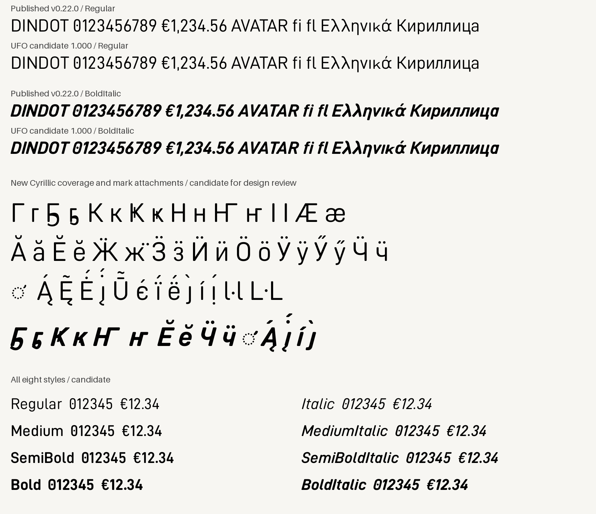

# Google Fonts engineering and review status

The unreleased **1.000 candidate** has editable UFO sources and a standard
fontmake build. The published v0.22.0 ZIP and live specimen are unchanged.
Submission: [google/fonts#11316](https://github.com/google/fonts/issues/11316).
Google Fonts acceptance and naming approval remain pending.

## Result on 14 November 2026

The Google Fonts Fontspector profile reports **762 PASS, 93 WARN, 8 FAIL,
477 SKIP and 94 INFO**, with **no ERROR or FATAL** results. The command exits 1.
All eight failures are the same family-name policy check: `DINDOT` contains
an abbreviation. The menu name remains DINDOT; a naming exception is requested.
The new Cyrillic designs still need native-reader and Google Fonts design review.

Compared with the [original v0.22.0 report](initial-v022/README.md), every other
failing check category has been resolved. Warnings remain visible in the full
report and are not waived or represented as final production approval.

| Original failure | Candidate change |
| --- | --- |
| Editable font sources/build | Eight maintained UFO 3 sources; fontmake and ttfautohint build directly from them. |
| RIBBI name records | Remove redundant typographic family/subfamily records for Regular, Italic, Bold and Bold Italic. |
| Version below 1.000 | Candidate internal version is 1.000. It is not a released version tag. |
| Multiline copyright | Single-line notices retain upstream attribution. |
| 8192 UPM | 2048 UPM, with all original outlines and advances compared geometrically. |
| Dotted-circle horn attachment | Add the missing horn anchor/positioning. |
| Language shaping | Complete reported mandatory Cyrillic orthographies, add missing top/bottom attachments and mark stacking, and fix soft dots before accents. |
| Repository directory mismatch | Preferred upstream `sources/`, `fonts/ttf/` and `fonts/webfonts/` layout; QA stages a downstream `dindot/` directory as expected by that check. |
| DINDOT family-name policy | **Pending Google Fonts review.** Upstream RFN context is documented separately. |

## Evidence

- [Full current Fontspector report](fontspector-googlefonts.md)
- [Result and warning counts](qa-summary.json)
- [Latin Core coverage](latin-core-coverage.json)
- [Outline, shaping and repeat-build checks](regression-checks.json)
- [One-time source migration record](source-migration.json)
- [Upstream notices and reserved-name review](upstream-licenses/README.md)
- [Draft catalog description](DESCRIPTION.en_us.html), subject to editorial approval



The proof uses HarfBuzz shaping and FreeType rasterization. It is generated
by `scripts/render_proof.py`; its image notice is in `../image-license.txt`.

## Regression checks

All eight faces retain the original **949** encoded characters and add **38**,
for **987** per face. The required Latin Core list has **324 glyph entries**:
319 encoded entries plus the unencoded forms. All are covered, allowing the
published nice-name/Adobe-name aliases documented in the validator.

The regression check compares **all 1,221 original glyphs per face** (9,768
comparisons). The largest sampled outline distance is **0.7072 or less in
2048-unit coordinates**, and the largest advance difference is **0.5 units**.
These are within the smaller grid's rounding tolerance. Outline comparison
samples Bezier segments at 16 intervals and uses symmetric Hausdorff distance;
it is an automated geometry comparison, not a proof of pixel-identical rendering.
Hinting has been rebuilt and low-resolution rasterization may differ.

**126 shaping cases per face** (1,008 total) compare substitution behavior and
positioning, including numeric features and Catalan, Polish, Dutch, Romanian
and Bulgarian feature inheritance. Corrected accent sequences have separate
attachment and advance-preservation checks. TTF/WOFF2 semantic tables match.
Two isolated builds produce **byte-identical output for all 16 font files**.
The original 0.22-era procedural build did not guarantee exact-byte regeneration;
this new result applies to the UFO candidate, not retroactively to that release.

## Reproduce

Use Python 3.12, install `requirements-qa.txt`, and run:

```sh
python verify_release.py
python scripts/fetch_reference.py
python sources/build.py --output-dir .cache/build-one
python sources/build.py --output-dir .cache/build-two
python scripts/validate_fonts.py \
  --reference .cache/reference/DINDOT-v0.22.0 \
  --fonts .cache/build-one --repeat .cache/build-two \
  --report .cache/regression-checks.json
python scripts/render_proof.py \
  --reference .cache/reference/DINDOT-v0.22.0 \
  --fonts .cache/build-one --output .cache/readiness-proof.png
```

For the full Google Fonts profile, install official Fontspector and run:

```sh
python scripts/qa_googlefonts.py --fontspector /path/to/fontspector
```

The official `fontspector-v1.9.1` Apple Silicon release asset was used for the
recorded run. Its executable and report identify it as **1.9.0**, commit
`990bb930`. The check stages TTFs and OFL.txt under a downstream `dindot/`
directory; the maintained upstream layout remains `fonts/ttf/`.

Remaining warnings include optional language/orthography coverage, legacy
unreachable alternates, the intentionally dotted zero's extra contours,
soft-hyphen policy, a mathematical-width exception, small rounding/outline
observations, a static STAT-table advisory and downstream subset metadata.
They need review during onboarding. No complete downstream METADATA.pb or
Google Fonts web subsets are claimed by this upstream candidate.

## Sources, authorship and AI assistance

See [the maintained source documentation](../../sources/README.md). The UFOs
were initially exported from the licensed DINDOT release, not recovered as
original upstream drawing masters. The historical procedural sources and
DINish inputs are retained in `sources/procedural/`; ordinary builds do not
extract sources from binaries or invoke that generator.

DINDOT is a derivative of DINish, with the original DINish, Altinn-DIN and
D-DIN lineage credited in AUTHORS.txt and the upstream review. AI assistance
has been used under Rick Radewagen's direction for tooling, source conversion,
metadata, new glyph construction, QA, documentation and submission preparation.
The original upstream outlines are not claimed as our sole original work.
