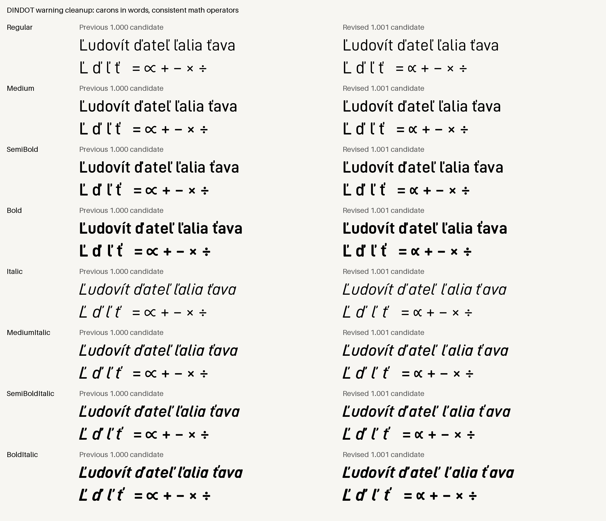

# Google Fonts engineering and review status

The unreleased **1.001 candidate** includes the warning cleanup requested on
18 November 2026. The published v0.22.0 ZIP and live specimen remain unchanged.
Submission: [google/fonts#11316](https://github.com/google/fonts/issues/11316).
Google Fonts acceptance, naming approval and final design review remain pending.

## Current QA

The raw Google Fonts Fontspector profile reports **823 PASS, 24 WARN, eight
FAIL, 453 SKIP and 94 INFO**, with **no ERROR or FATAL** results. It exits 1.
All eight failures concern the same DINDOT abbreviation/naming-policy decision.
The warning count fell from **93 to 24**, resolving 69 warning results.

| Resolved warning | Change |
| --- | --- |
| Missing static STAT table | Weight and boolean italic axes, with the upright/style linking and flags. |
| Uncheckable decomposed carons | Real base + distinct alternate-caron components; visible mark/body clearance at every weight. |
| Math-width outlier | Redraw the proportional-to sign at the standard operator advance, retaining the weight's stroke thickness. |
| Soft hyphen | Leave U+00AD to the shaping engine; discretionary text keeps its normal unbroken width. |
| Unreachable glyphs | Keep six legacy marks editable in the UFOs, but omit them from export; the alternate caron now has real component uses. |
| Collinear/zero-length segments | Remove redundant source geometry and fit tiny gentle turns with bounded tangent quadratics. |
| Nearly upright lines | Snap tiny unintended axis deviations in upright styles. |

The 24 remaining warnings are **three categories repeated across eight faces**:
intentional dotted-zero contour counts, optional orthography coverage, and the
downstream Google Fonts subset-serving plan. They are documented with evidence
in [review-notes.md](review-notes.md). The raw findings are not suppressed,
reclassified or claimed as waived. The new Cyrillic forms from candidate 1.000
also remain subject to native-reader/Google Fonts design review.

## Evidence

- [Full current Fontspector report](fontspector-googlefonts.md)
- [Counts and resolved-warning summary](qa-summary.json)
- [1.001 source-maintenance changes](warning-cleanup-changes.json)
- [Regression checks](regression-checks.json)
- [Independent-build hashes](build-repeatability.json)
- [Zero-design, repertoire and caron-gap verification](review-design-verification.json)
- [Latin Core coverage](latin-core-coverage.json)
- [Optional coverage inventory](optional-coverage-review.json)
- [Subset-serving inventory](subset-serving-audit.json)
- [Archived 1.000 candidate](candidate-1.000/README.md)
- [Initial v0.22.0 QA](initial-v022/README.md)
- [Upstream name and license review](upstream-licenses/README.md)




The proofs use HarfBuzz shaping and FreeType rasterization. The image notice
is in `../image-license.txt`.

## Regression checks

The candidate has **986 encoded characters per face**. All previous 987 remain
except U+00AD SOFT HYPHEN, deliberately handled by the shaping engine. Compared
with the original v0.22.0 release, this is 38 added characters and that one
removed control character. All **324 Latin Core glyph entries** are covered:
319 encoded entries and five unencoded forms, allowing the published nice-name
and Adobe-name aliases documented in the validator.

**1,209 original glyphs per face** (9,672 total) have unchanged-design geometry
and advance comparisons. The largest observed sampled outline distance is
below **1.872/2048 em**, with advance differences no greater than **0.5/2048 em**.
The ordinary limit remains 1.5 units; specifically recorded outline-cleanup
cases have a 2.5-unit limit. Curve smoothing bounds the corner displacement to
1.5 units. Comparison samples Beziers at 16 intervals and uses symmetric
Hausdorff distance; this is not a claim of pixel-identical rendering.

The four caron letters and proportional-to sign are intentional revisions and
have separate structure/metric checks and visual proof. The caron tests verify
the actual base/mark components and offsets, recorded advances and at least
20 units of compiled outline clearance. Six unencoded dead marks and the soft
hyphen are excluded from the unchanged-glyph comparison and verified as absent
from the exports. Their source provenance is recorded explicitly.

**1,008 shaping regression cases** cover numeric features and language feature
inheritance. Corrected mark sequences and soft-hyphen behavior have separate
checks. TTF/WOFF2 semantic tables match, including STAT and meta. Two independent
builds reproduce **all 16 font files byte for byte**. CI rebuilds on Linux and
compares the checked-in outputs as well as running the full profile and tests.

## Reproduce

Use Python 3.12, install `requirements-qa.txt`, and run:

```sh
python verify_release.py
python scripts/fetch_reference.py
python sources/build.py --output-dir .cache/build-one
python sources/build.py --output-dir .cache/build-two
python verify_release.py --compare .cache/build-one
python scripts/validate_fonts.py \
  --reference .cache/reference/DINDOT-v0.22.0 \
  --fonts .cache/build-one --repeat .cache/build-two \
  --report .cache/regression-checks.json
python scripts/verify_review_designs.py --fonts .cache/build-one
```

For the unfiltered Google Fonts profile:

```sh
python scripts/qa_googlefonts.py --fontspector /path/to/fontspector
```

The official `fontspector-v1.9.1` Apple Silicon release asset was used; its
executable/report identifies it as **1.9.0**, commit `990bb930`. It was still
the latest executable release when checked on 18 November. The Latin Core
fixture also matches the current upstream file. QA stages a downstream
`dindot/` directory, while maintained binaries remain in `fonts/ttf/`.

CI downloads the pinned official Linux asset and verifies its SHA-256 digest.
The `--assert-known-findings` project gate rejects new warning/failure types,
ERRORs or FATALs. It explicitly retains the known raw findings for review;
passing this regression gate is not a Google Fonts waiver or acceptance.

## Sources, authorship and AI assistance

The eight [maintained UFO sources](../../sources/README.md) were initially
exported from the licensed 0.22.0 release. They are not claimed as recovered
original drawing masters. Normal builds use the UFOs directly. The historical
procedural code and DINish inputs remain in `sources/procedural/`.

The one-time 1.001 source maintenance is recorded in
`scripts/prepare_1001_candidate.py`; it is not run by normal builds. DINDOT's
DINish, Altinn-DIN and D-DIN lineage remains credited. AI assistance has been
used under Rick Radewagen's direction for tooling, source conversion, metadata,
glyph construction, source maintenance, QA, documentation and submission work.
